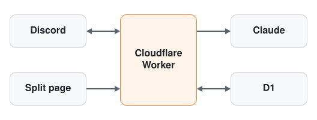

# AAzhi

A Discord bot that splits a restaurant bill from a photo of the receipt.

The name comes from AA制 (AA zhì), Chinese for going Dutch: everyone pays for
what they had. No accounts or installs: Discord already knows who everyone is.

## How it works for the group

1. The payer runs `/split` with a receipt photo.
2. The bot reads the line items and checks they add up to the printed total.
3. Everyone taps **Open the split** and claims their dishes on a private web
   page. Shared plates split between whoever claims them.
4. The payer confirms on the page. Each share includes proportional tax, tip
   and any whole-bill discount, in exact integer cents that sum to the total.
5. The page links to the payer's Venmo with your amount and a note filled in.
   **I paid** records the payment, and the bot tells the channel.

Run `/debts` to see who owes you and who you owe, with a link to pay each bill.
The payer can mark someone paid on the page when they're handed cash.

Run `/profile` to see your months, your favorite place and who you go out with.
`/profile @someone` shows theirs. Your numbers count every server you eat with.
The boards rank the people in this server by Hosted, Spent and Unique visits,
using those same totals. Bills stay in the server they were made in.

<picture>
  <source media="(prefers-color-scheme: dark)" srcset="docs/img/architecture-dark.svg">
  
</picture>

One Cloudflare Worker serves Discord and the split page, with D1 for storage
and Claude for reading receipts. Details: [docs/architecture.md](docs/architecture.md).
Why this stack: [docs/stack.md](docs/stack.md).

## Local development

Needs Node 22.

```sh
npm ci
npm test                                     # no secrets or network needed
npx wrangler d1 migrations apply DB --local && npx wrangler dev
```

To deploy your own copy, see [docs/setup.md](docs/setup.md).
