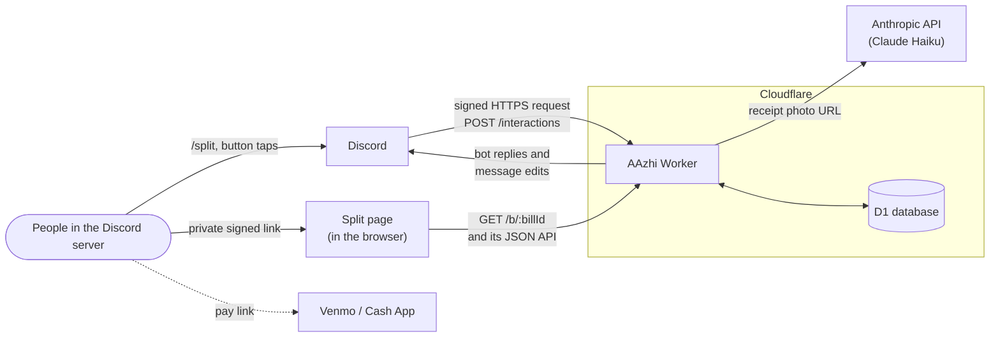

# AAzhi

A Discord bot that splits a restaurant bill from a photo of the receipt.

The name comes from AA制 (AA zhì), the Chinese term for going Dutch: everyone
pays for what they had.

## The problem

Eight people go out to eat and one card covers the whole thing. Everything
after that is unpaid work for whoever paid: dividing the receipt, working out
that the person who ordered the $45 steak owes more tax than the person who
ordered the $12 soup, posting eight numbers in a group chat, then remembering
for two weeks who still hasn't sent anything.

AAzhi does that work inside the Discord server the group already uses. Nobody
creates an account, installs anything, or logs in: Discord already knows who
everyone is, so a tap on a button is proof of who tapped it.

## How it works for the group

1. **Snap the receipt.** The person who paid runs `/split` with a photo of the
   receipt attached (or right-clicks a message with the photos and picks
   *Apps > Split this receipt*).
2. **The bot reads it.** A few seconds later the bot posts the bill: every line
   item, the tax, and whether the items plus tax add up to the total printed on
   the receipt.
3. **Everyone claims what they had.** Each person taps **Open the split** and
   gets a private link to a web page for that bill. On the page they tap their
   name onto the dishes they ate. A shared plate is split between exactly the
   people who tap it. The payer can also add the tip, fix a misread line, add
   friends who aren't on Discord as guests, and tap people onto lines for them.
4. **The payer confirms.** Once every line is claimed and the receipt adds up,
   the payer taps **Confirm**. The amounts lock, and the message turns into a
   card showing who owes the payer what, with each person's share of tax and
   tip in proportion to what they ordered.
5. **Everyone pays.** **Pay my share** opens Venmo or Cash App with the payer's
   handle and the exact amount filled in (Zelle gets written instructions).
   **I paid** records the payment, in full or in part, and the bot says so in
   the channel. `/ledger` shows the payer who still owes them, across every
   bill.

If someone is charged for something that isn't theirs, they tap **That's not
mine**. The bill goes back to a draft and paying pauses until the payer fixes
it and confirms again.

## Correctness

Money arithmetic is the part that has to be exactly right, so two guarantees
are built in rather than hoped for.

**The receipt proves its own read.** A receipt prints its own total, so the
extracted line items plus the extracted tax are checked against it. If they
don't reconcile to the cent, the bill cannot be confirmed and the page shows by
how much it is off. The vision model never has to be perfect, which it won't be.

**The column always adds up.** All money is integer cents, never floating
point, and per-person shares are rounded by largest remainder so the shares sum
to the printed total plus the tip, exactly. A bill that doesn't reconcile has
lied about money to people who trust each other, which is the one unrecoverable
failure.

## Architecture

The whole app is one Cloudflare Worker (a small program Cloudflare runs on
demand, per request, with no server to keep running) plus a SQLite database
next to it. Discord calls the Worker over HTTPS whenever someone uses a command
or taps a button; the Worker never holds a connection open to Discord.



- **Discord interactions** arrive at `POST /interactions`. Each request is
  signed by Discord and checked before anything else runs.
- **Receipt reading** sends the photo's Discord URL to Claude, which returns
  the items as structured data. Photos are never stored.
- **The split page** is served by the same Worker at `/b/<bill id>`. Its link
  carries a signed, 30-minute token naming one person on one bill, which is the
  only login the page has.
- **D1** holds bills, items, who claimed what, the frozen shares, payments, and
  payment handles.

The full walkthrough, following one bill from photo to settled payment and
naming the file behind each step, is in
[docs/architecture.md](docs/architecture.md).

## Stack

- **TypeScript on Cloudflare Workers**: no always-on process, no cold start
  against Discord's three-second deadline.
- **Hono**: a small router built for Workers.
- **Cloudflare D1**: SQLite, because claims and shares are relational.
- **Claude Haiku 5.5 on the Anthropic API**: reads the receipt, at about
  $0.00083 per receipt.
- **Vitest with `@cloudflare/vitest-plugin`**: tests run inside the real
  Workers runtime against a real D1 database.
- **GitHub Actions**: type-checks, tests, migrates and deploys on every push to
  `main`.

Hosting, storage and the web page fit in free tiers with no expiry and nothing
that sleeps; reading receipts is the only cost. Why each piece was chosen, and
what was rejected: [docs/stack.md](docs/stack.md).

## Local development

Needs Node 22.

```sh
npm ci
npm test                                     # unit and integration tests
npm run typecheck                            # tsc --noEmit
npx wrangler d1 migrations apply DB --local  # create a local database
npx wrangler dev                             # serve the Worker locally
```

The tests need no secrets and make no network calls. `wrangler dev` reads
secrets from a git-ignored `.dev.vars` file; without one it still starts, but
Discord requests fail signature checks and page links are refused.

## Running your own copy

Deploying it means registering a Discord app, creating the Cloudflare Worker
and database, storing five secrets, and wiring up the deploy workflow. The
step-by-step guide is [docs/setup.md](docs/setup.md). What each credential is,
who issues it, and what a leak would expose:
[docs/architecture.md#credentials-and-what-each-one-is-for](docs/architecture.md#credentials-and-what-each-one-is-for).

## Project docs

- [docs/architecture.md](docs/architecture.md): how every piece works together.
- [docs/setup.md](docs/setup.md): deploying your own copy.
- [docs/stack.md](docs/stack.md): why this stack.
- [docs/specs](docs/specs) and [docs/plans](docs/plans): the original design
  and build plan, kept as history. Where they disagree with the code, the code
  and docs/architecture.md are current.
