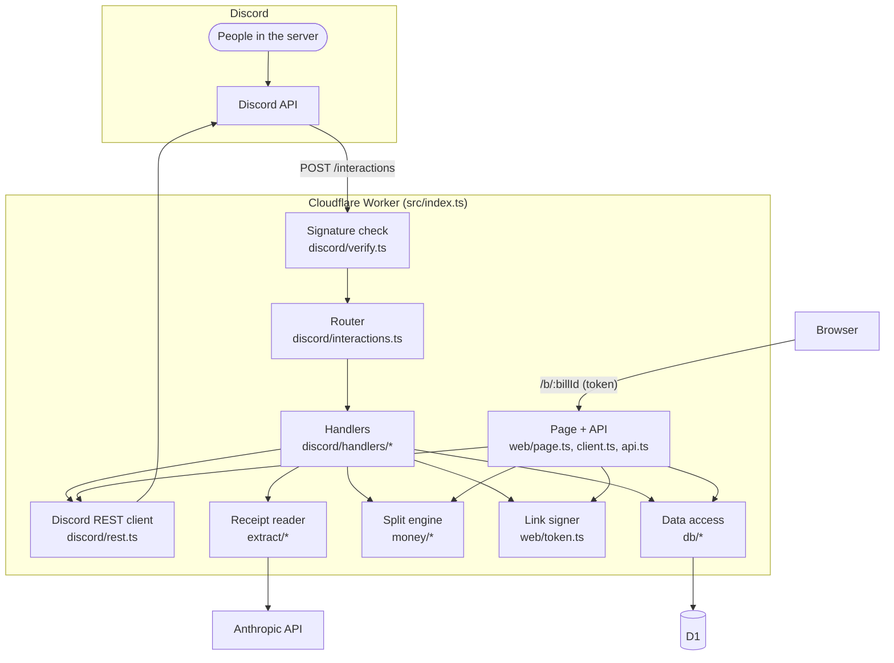
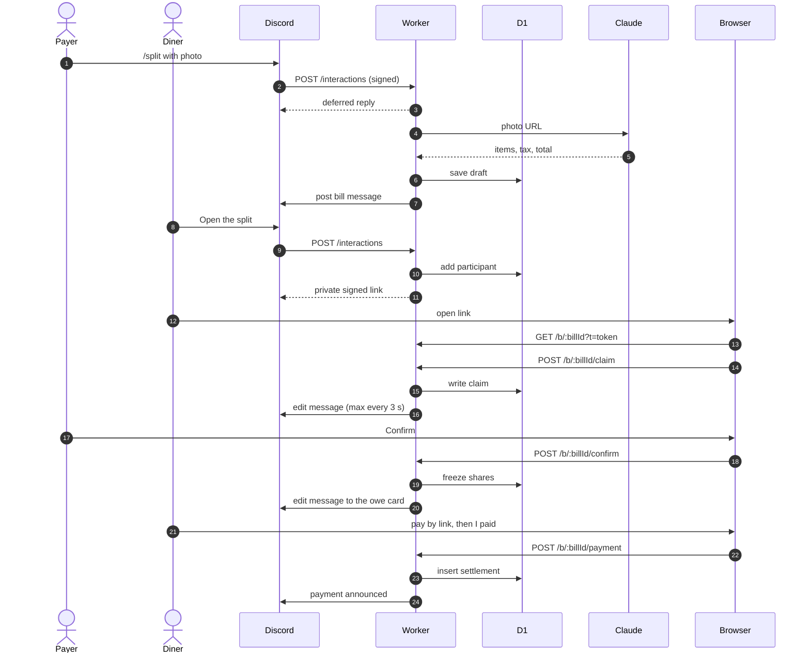

# Architecture

How one bill moves from a receipt photo to settled payments. Setup and
credentials are in [setup.md](setup.md). Technology choices are in [stack.md](stack.md).

## Components

- **Cloudflare Worker**: all server code, run by Cloudflare once per request,
  with nothing idling in between. Entry: `src/index.ts`.
- **D1**: Cloudflare's hosted SQLite, passed to the Worker as the `DB` binding.
  Schema: `migrations/`.
- **Discord**: forwards every command and button tap to the Worker's
  *interaction endpoint* (`POST /interactions`) and needs a reply within 3 s.
- **Claude Haiku** (Anthropic API): reads the receipt into structured data.
- **Split page**: HTML and a JSON API served by the same Worker at `/b/<bill id>`.

## One bill, step by step

**1. `/split`.** Discord POSTs the interaction. `src/discord/verify.ts` checks
its Ed25519 signature (a public-key signature only Discord can make) against
`DISCORD_PUBLIC_KEY`, and rejects timestamps over 5 minutes old. The
`custom_id` prefix of each button tells `src/discord/interactions.ts` which
handler to call. Reading takes longer than 3 s, so
`src/discord/handlers/split.ts` replies "thinking..." at once and continues in
`ctx.waitUntil` (work allowed to run after the response).

**2. Reading the receipt.** `src/extract/claude.ts` sends the photo's Discord
URL to Claude with a forced tool call (a fixed JSON schema in
`src/extract/schema.ts`), so the photo never passes through the Worker or gets
stored. Prices arrive as strings and are parsed into integer cents. A
discount for the whole bill is kept apart from the lines, since nobody claims
it. Then the items, less that discount, plus tax are checked against the
printed total. A bill that doesn't match can be fixed but not confirmed.

**3. Saving and posting.** `src/db/bills.ts` writes the draft to D1. Each
change bumps the bill's `revision`, so a confirm sent from an older version
is refused. `src/discord/render.ts` draws the message, and
`src/discord/rest.ts` posts it with the *interaction token* (a 15-minute
credential to edit that reply). The message is a notice: the total, who
paid, any problem, what is unclaimed, and one **Open the split** button.
Everything else is done on the page.

**4. Joining.** **Open the split** (`src/discord/handlers/roster.ts`) adds the
tapper to the bill and replies privately with
`/b/<bill id>?t=<token>`. The token (`src/web/token.ts`) is HMAC-signed: JSON
naming the bill, the person and a 30-minute expiry, plus a signature only
`TOKEN_SIGNING_KEY` can produce. It is the page's only login.

**5. Claiming.** `src/index.ts` checks the token before loading the bill and
serves `src/web/page.ts` with the client script from `src/web/client.ts`. The
script calls `src/web/api.ts` with the token as a Bearer header. People claim
their own lines and can add guests, whom they tap onto lines and answer for
(`src/money/debtors.ts` decides who owes for whom). The payer can also edit
lines, the discount, tax, tip and anyone's guests. Writes
only land while the SQL `WHERE` still sees a draft. The page polls every
5 s. The Discord message updates at most every 3 s per bill, through a lease
stored in D1, since Worker instances share no memory.

**6. Confirming.** The payer taps Confirm on the page (`POST
/b/:billId/confirm`). `confirmBill` (`src/db/bills.ts`) requires the payer, a
current revision, a matching total and every line claimed. Unclaimed lines
can instead be split evenly between everyone who claimed something.
`src/money/split.ts` splits each line between its claimants and gives the
whole-bill discount, tax and tip in proportion to subtotal.
Largest-remainder rounding (round everyone
down, then give spare cents to the largest fractions) makes shares sum to the
cent. The shares are frozen in the `shares` table, and the message becomes
the owe card.

**7. Paying.** Anyone on a bill can save their Venmo username from the page
(`src/db/handles.ts`). Once the bill is confirmed, the page shows a Venmo button
for what you have left: the `venmo://` link on a touch screen, the https link
on a computer (`src/web/paylink.ts`). Only Venmo fills in the amount and the
note from a link, so it is the only app.

**8. Recording.** Someone has paid or they haven't. **I paid** on the page
(`POST /b/:billId/payment`) records everything they have left, guests they
brought included, in `settlements` (`src/db/settlements.ts`). The checks run
inside the insert, so a stale or part amount is refused, and the page's own
id for the payment makes a retry land once. The payment is announced in the
channel (`src/discord/notices.ts`), and `/ledger` totals who still owes the
payer. The payer sees who paid on the page and can undo someone's paid if it
never arrived (`DELETE /b/:billId/paid/:participantId`). A guest has no
Discord account, so the payer marks them paid on the page instead; that is a
settlement against the guest, and it counts toward whoever answers for them.

**9. Corrections.** **Something's wrong** (anyone on the bill) or **Edit the
bill** (the payer) on the page returns the bill to draft and pauses paying.
Re-confirming announces any changed amounts. The payer can also delete the
bill. Bill messages posted before the page took over still carry the old
buttons, so `src/discord/handlers/retired.ts` answers those taps with a
pointer to Open the split.

## Deployment

On each push to `main`, `.github/workflows/deploy.yml` type-checks, tests,
applies D1 migrations, then runs `wrangler deploy`. Tests run inside workerd
(the Workers runtime) against a real D1 database.
