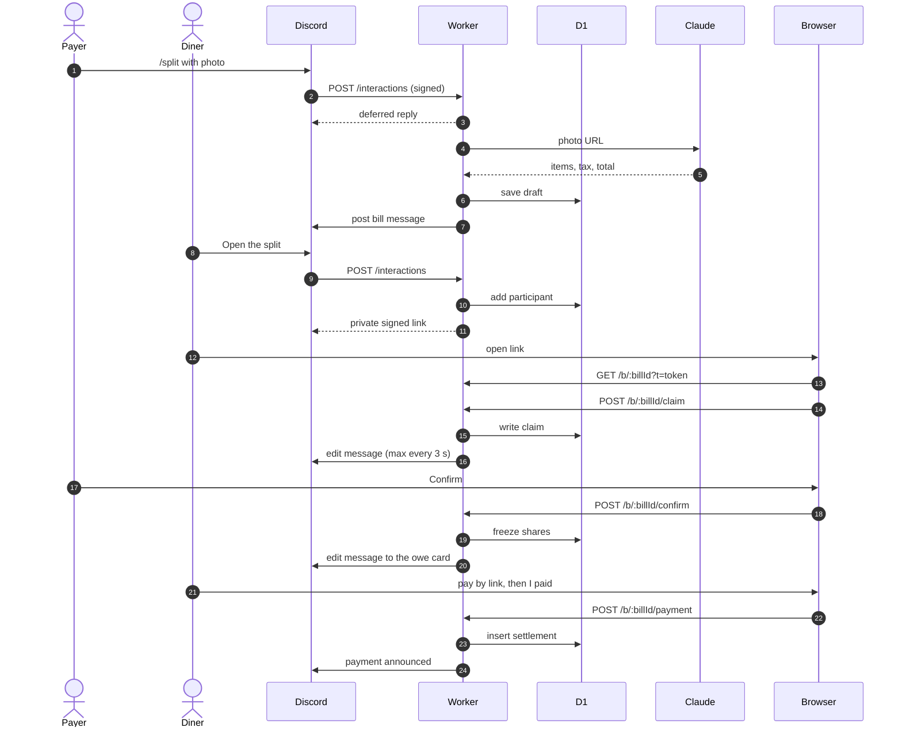

# Architecture

How one bill moves from a receipt photo to settled payments. Setup and
credentials are in [setup.md](setup.md). Technology choices are in [stack.md](stack.md).

## Components

- **Cloudflare Worker**: all server code, run by Cloudflare once per request,
  with nothing idling in between. Entry: `src/index.ts`.
- **D1**: Cloudflare's hosted SQLite, passed to the Worker as the `DB` binding.
  Schema: `migrations/`.
- **Discord**: forwards every command and button tap to the Worker's
  *interaction endpoint* (`POST /interactions`) and needs a reply within 3 s.
- **Claude Haiku** (Anthropic API): reads the receipt into structured data.
- **Claude Sonnet** (Anthropic API): for `/log` only, decides whether the
  receipt photo is real (`src/extract/fake-check.ts`).
- **Split page**: HTML and a JSON API served by the same Worker at `/b/<bill id>`.
- **Profile pages**: HTML from the same Worker at `/g/<server id>`, which only
  ever write your logs and which stamps you've seen.

## One bill, step by step

**1. `/split`.** Discord POSTs the interaction. `src/discord/verify.ts` checks
its Ed25519 signature (a public-key signature only Discord can make) against
`DISCORD_PUBLIC_KEY`, and rejects timestamps over 5 minutes old. The
`custom_id` prefix of each button tells `src/discord/interactions.ts` which
handler to call. Reading takes longer than 3 s, so
`src/discord/handlers/split.ts` replies "thinking..." at once and continues in
`ctx.waitUntil` (work allowed to run after the response).

**Read limits.** Each Claude call spends credits, so `grantRead` in
`src/extract/read-limit.ts` counts it in D1 first. A person gets 5 reads a rolling
hour and 15 a day across all servers, and the bot gets 100 a day. Days turn over
at midnight in Los Angeles. A photo is one read, and a read carries at most three,
so a big receipt costs what it costs Claude. A retry counts as another read. A
read that fails or gets refused stays counted, because it was still billed.

The count happens before the reply, so a refusal can stay private, and one insert
decides it, so simultaneous commands can't slip past. If the counter can't answer
in two seconds, nothing is read and the person is told to try again.
`extractReceipt` and `looksFake` take only the permit `grantRead` hands out, so a
new command can't reach Claude around the limit. A `/log` makes two Claude calls
on one read, the Haiku read and the Sonnet check, so it costs more than the count
shows. `receipt_reads` keeps two days of rows and
clears older ones on each new read.

**2. Reading the receipt.** `src/extract/claude.ts` sends the photo's Discord
URL to Claude with a forced tool call (a fixed JSON schema in
`src/extract/schema.ts`), so the photo never passes through the Worker or gets
stored. Prices arrive as strings and are parsed into integer cents. A
discount for the whole bill is kept apart from the lines, since nobody claims
it. Then the items, less that discount, plus tax are checked against the
printed total. A bill that doesn't match can be fixed but not confirmed.

**3. Saving and posting.** `src/db/bills.ts` writes the draft to D1. Each
change bumps the bill's `revision`, so a confirm sent from an older version
is refused. `src/discord/render.ts` draws the message, and
`src/discord/rest.ts` posts it with the *interaction token* (a 15-minute
credential to edit that reply). The message is a notice: the total, who
paid, any problem, what is unclaimed, and one **Open the split** button.
Everything else is done on the page.

**4. Joining.** **Open the split** (`src/discord/handlers/roster.ts`) adds the
tapper to the bill and replies privately with
`/b/<bill id>?t=<token>`. The token (`src/web/token.ts`) is HMAC-signed: JSON
naming the bill, the person and a 30-minute expiry, plus a signature only
`TOKEN_SIGNING_KEY` can produce. It is the page's only login.

**5. Claiming.** `src/index.ts` checks the token before loading the bill and
serves `src/web/page.ts` with the client script from `src/web/client.ts`. The
script calls `src/web/api.ts` with the token as a Bearer header. People claim
their own lines and can add guests, whom they tap onto lines and answer for
(`src/money/debtors.ts` decides who owes for whom). The payer can also edit
lines, the discount, tax, tip and anyone's guests. Writes
only land while the SQL `WHERE` still sees a draft. The page polls every
5 s. The Discord message updates at most every 3 s per bill, through a lease
stored in D1, since Worker instances share no memory.

**6. Confirming.** The payer taps Confirm on the page (`POST
/b/:billId/confirm`). `confirmBill` (`src/db/bills.ts`) requires the payer, a
current revision, a matching total, every line claimed, another Discord member
with a share above $0 and a receipt no other confirmed bill holds. Unclaimed lines can instead be split evenly between
everyone who claimed something.
`src/money/split.ts` splits each line between its claimants and gives the
whole-bill discount, tax and tip in proportion to subtotal.
Largest-remainder rounding (round everyone
down, then give spare cents to the largest fractions) makes shares sum to the
cent. The shares are frozen in the `shares` table, and the message becomes
the owe card.

**7. Paying.** Anyone on a bill can save their Venmo username from the page
(`src/db/handles.ts`). Once the bill is confirmed, the page shows a Venmo button
for what you have left: the `venmo://` link on a touch screen, the https link
on a computer (`src/web/paylink.ts`). Only Venmo fills in the amount and the
note from a link, so it is the only app.

**8. Recording.** Someone has paid or they haven't. **I paid** on the page
(`POST /b/:billId/payment`) records everything they have left, guests they
brought included, in `settlements` (`src/db/settlements.ts`). The checks run
inside the insert, so a stale or part amount is refused, and the page's own
id for the payment makes a retry land once. The payment is announced in the
channel (`src/discord/notices.ts`). The payer sees who paid and who hasn't on
the page, can mark someone paid when the money reached them another way, say
cash at the table (`POST /b/:billId/paid/:participantId`, the same settlement
with the payer as `recorded_by`), and can undo someone's paid if it never
arrived (`DELETE /b/:billId/paid/:participantId`). A guest has no Discord
account, so the payer marks them paid on the page instead; that is a settlement
against the guest, and it counts toward whoever answers for them.

`/debts` is a private reply with both directions, one line per confirmed bill:
what you're owed by person, and what you owe by person, each line linking to
that bill's page. A reopened bill is out until it is confirmed again, since its
amounts are about to change. The links are ordinary 30-minute bill links minted
for the reply. Each costs about 250 of Discord's 2000 characters, so only six
or so fit; the rest fold into a line carrying their total.

**9. Corrections.** **Something's wrong** (anyone on the bill) or **Edit the
bill** (the payer) on the page returns the bill to draft and pauses paying.
Re-confirming announces any changed amounts. The payer can also delete the
bill. Bill messages posted before the page took over still carry the old
buttons, so `src/discord/handlers/retired.ts` answers those taps with a
pointer to Open the split.

## One log

A log is a bill with one person on it, so it runs the same draft, claim and
confirm code as `/split`. `kind` on `bills` tells them apart. It records what
you spent on a meal nobody else in the server was at, with nothing owed.

**1. `/log`.** `src/discord/handlers/log.ts` answers privately. It refuses at
once in a channel where the bot can't post, because the post is the point.
Haiku reads the receipt while Sonnet judges the photo, side by side. Nothing
is saved if the receipt is more than 8 hours past its printed time, has no
time and isn't from today, or has no date or total. Dates are compared in
Pacific time (`src/extract/receipt-time.ts`), and the clock is the server's.

**2. One receipt, one credit.** A log has its own key from
`logReceiptKey` (`src/extract/receipt-key.ts`). It is the split key when the
receipt prints a time. Without one, the key also holds the person, so two
people's lunches with the same total can't collide. A unique index holds one
counted log per key, so two people racing still get one. The refusals are
"This receipt was already logged." and, for a receipt on a confirmed split,
"This receipt was already split."

**3. Picking items.** The private link opens the same page as a split, for the
logger only: the token check returns 403 to anyone else. Prices, guests, tax
and the roster are refused on a log (`splitRoute` in `src/web/api.ts`). The
name of the place can be typed in if the read found none, and fixed later.

**4. Log it.** `confirmBill` runs without the split's need for a second person
and requires a place, at least one item, and items no higher than the printed
total. The bot posts `@person spent $X at Place` to the channel, without
pinging anyone. The log still stands if that post fails, and the page says so.

**5. A receipt that looks fake.** The check runs beside the read and is acted
on as soon as it answers, before the items page. A fake call replies privately,
"This receipt looks fake, so I didn't log it." A failed check replies "I couldn't
check this receipt, so try again." Either way nothing is saved and nothing reaches
the channel. To correct a wrong call, run `/log` again with a clearer photo. The
old Real and Fake buttons only answer "This vote is over." The `bills.vote` and
`bills.photo_urls` columns and the `log_votes` table are unused until a later
migration drops them.

**6. A log and a split.** Confirming a split of the same receipt removes the
logs of the people on that split and deletes their posts, because the split
now holds their real share. Anyone not on the split keeps their log.

Logs add to Spent, Places and the favorite place, but not Hosted or
Fronted, because nobody was hosted. **Your logs** on your own `/profile` lets
you rename or remove them after the page's 30-minute link has run out
(`src/web/logs.ts`).

## Profiles and boards

`/profile` answers privately with only an **Open profile** link.
`/profile @someone` does the same for them, even if they have no bills.
`/leaderboard` answers privately with only an **Open leaderboard** link. The
link belongs to one viewer, so neither reply can be posted. The pages show a person's months as a mountain range, a few tiles, and
three boards: Hosted, Spent and Places. Nothing here writes to the database.
`src/db/stats.ts` holds every rule.

**Numbers count every server.** Eating out is one life, so a profile adds up
every confirmed bill a person is on, wherever it was made: spent, outings, the
Range, tiles, hosted and fronted. "No bills" means none anywhere, and the page
names no server. The per-server view is the monthly recap the bot will post in
the server, not these pages. Bills themselves stay separate: a bill page shows
nothing from other servers.

**The viewing server still matters in three places.**

- **Names.** People go by different names in different groups, so a name comes
  from the viewing server when the person has one there, and otherwise from
  their latest bill anywhere.
- **Boards.** The rows are people with a confirmed bill in this server. Each
  number is that person's total from every server, for Month as well as All
  time.
- **Who opens.** A page opens for yourself, for someone with a confirmed bill in
  this server, or for someone `/profile @name` just named, because Discord only
  offers people in the server. A tile or pair card can name someone from another
  server, but with no link. Any other id is refused, and the refusal looks the
  same whether or not that person has bills elsewhere, so a link can't be walked
  to arbitrary accounts.

**Stamps stay in their server.** Unlike the numbers, a stamp is one person in one
server, so the card carries the server's name. There are ten, listed in
`src/db/stamps.ts`, and each rule reads the rows the stats already count.

- **Earning.** A stamp is checked after each confirm, payment, marked payment and
  forgiveness, for the people that write could move. Each check reads the rows
  from scratch, so a check that failed is made up at that person's next bill. A
  failure never fails the write it follows.
- **Logs.** A log earns First Seat, Regular, Traveler and Hundred Flavors and
  nothing else, the same line the stats draw between an outing and hosting.
- **Never taken back.** Undoing a payment, reopening a bill or removing a log
  leaves a stamp where it is. Nothing deletes from `stamps`.
- **Backfill.** `migrations/0012_stamps.sql` gives people what they already earned,
  dated when they crossed the line and marked seen. It folds names by ASCII only,
  so it can be a stamp short or over against the Worker's rules for names that
  differ by an accent. The Worker's check makes up a shortfall at the next bill.
- **The Ceremony.** A stamp with no `seen_at` plays once, one at a time, on
  whichever page the person opens next. It waits for a stamp press to finish, an
  open sheet, and on a bill for someone who still owes to pay. It's marked seen
  when the sheet appears, so a dropped connection shows it twice rather than never.
- **The post.** A stamp only ever adds a line to a post already going out, and a
  log's line survives a rename. The first Confirm of a split posts nothing, so
  nothing is said about what it earned.

**One receipt, one credit.** Numbers add up across servers, so a receipt split
twice would count one outing twice. A receipt is credited by at most one
confirmed bill, anywhere, same server included.

`/split` is refused when the receipt is already on a confirmed bill, and nothing
is saved. A draft stops nothing, because a forgotten one must not hold a receipt
hostage, so two drafts of one receipt can exist. The race ends at Confirm: the
second bill is refused, stays a draft, and its payer can delete it. Reopening or
deleting frees the receipt, and a reconfirm is checked again.

A unique index over confirmed bills (`migrations/0007_receipt_key.sql`) is what
holds this, so two Confirms at the same moment can't both land. The read in
`confirmBill` and on the page is there to give a clear answer sooner.

A receipt is matched by `receipt_key` (`src/extract/receipt-key.ts`), a hash of
the printed date, time and total and the sorted line prices. It is set at the
read and never changes, so fixing a price can't dodge it. It compares money, not
place names, because names read differently from one photo to the next.

Without a printed date, time or total there is no key and nothing is refused,
since refusing an honest receipt is worse than counting one twice. Two tills can
also print the same minute, total and prices, and the second is then refused.
Bills from before the key have none, because the printed time was never stored.

**The link belongs to the viewer.** A viewer token holds the server and the
viewer, not the person viewed, so one link can walk the whole server. It lasts
30 minutes, like a bill link. Its fields differ from a bill token's, so neither
can be read as the other. It also carries the server's name for the Leaderboard
header, because Discord leaves that out of interactions. The name is clipped to
40 characters to stay under Discord's 512-character limit on button links. If
the lookup fails, the page leaves the name out.

The link from `/profile @name` also carries `m`, a signature over that viewer
token and the person named. It is what lets the page open someone with no bill
in this server. It is a bare signature rather than a third token because that
button is close to Discord's limit, and it expires with the token it signs.

**What counts.**

| Stat | Counts | Leaves out |
|---|---|---|
| Outings | Confirmed bills that count for you | Drafts, reopened, deleted and replaced bills |
| Hosted | Bills that count for you and that you paid | Bills you paid with a $0 share of your own |
| Spent | Your own share at confirm, paid or not | Forgiven shares and guests |
| Places | Distinct places, after folding | Bills with no place name |

A bill counts for you only if your share is above $0 and someone else's is too.
This applies to every stat, including Went with and You and Marcus. Tapping Open
the split puts anyone on a bill, so a share is what shows they were there. A
guest with a share is someone else. A forgiven share still counts as being there.

A new bill can't reach this alone. Confirm is refused until another Discord
member has a share above $0. A guest doesn't satisfy that, since a guest isn't
on Discord to settle up. The check runs on the server in
`confirmBill`, and the page blocks the button with the same rule. It sits at
Confirm rather than `/split` because nobody else has joined a bill when `/split`
runs: people join afterward, through Open the split.

Bills confirmed before that rule stay as they are, so the stats rule above still
has work to do. A one-person bill counts on no stat. A bill with only a guest
beside the payer still counts, which is why a guest is "someone else" there. The
rule is one clause in `src/db/stats.ts`, so a later kind of bill made to count
alone can be let through.

Spent counts at confirm so that not paying can't lower a total, and a past
month never changes later. "Hosted" means the payer. The word has nothing to do
with the member who added a guest.

**Folding.** "SAIGON KITCHEN." and "Saigon Kitchen" are the same place. Folding
happens in TypeScript, not SQL, because SQLite's `lower()` only knows ASCII. It
removes accents but keeps marks that are part of a letter, such as Thai vowels.

**A bill's month.** The printed date counts only within 7 days of the day the
bill was made. Otherwise a misread year would move the bill to another month.

**Boards.** Ties share a rank and the next rank skips: 1, 1, 3. The Month board
shows the current month, or last month until this month has a bill, so the 1st
is never empty. All six lists come down in one page and the tabs only choose
which one shows. The links carry the open board and span, so the Leaderboard tab
and the Back to leaderboard chip return to the same list.

**The Range page.** The axis starts at the person's first month, up to the last
12. A quiet month is a low swell and not a gap, so the ridge never breaks.

**Fonts.** The rank numerals 一 二 三 are a separate face in the profile styles.
The bill page inlines its fonts on every load and has a size budget, so it does
not carry glyphs it never shows. The stamps are the exception to inlining: a file
at `/fonts/stamps.woff2`, which the profile styles name and the Ceremony fetches on
a bill page only when it has a stamp to show.

## Deployment

On each push to `main`, `.github/workflows/deploy.yml` type-checks, tests,
applies D1 migrations, then runs `wrangler deploy`. Tests run inside workerd
(the Workers runtime) against a real D1 database.

Slash commands are not part of the deploy. After a change to
`src/discord/commands.ts`, run `npm run register-commands` by hand.
