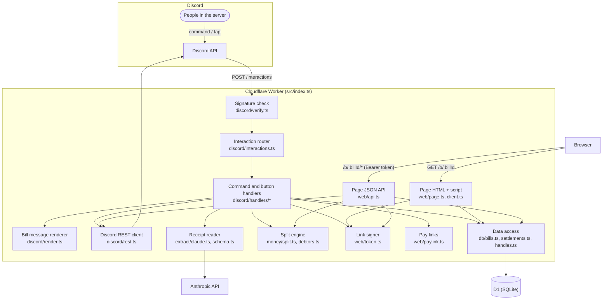
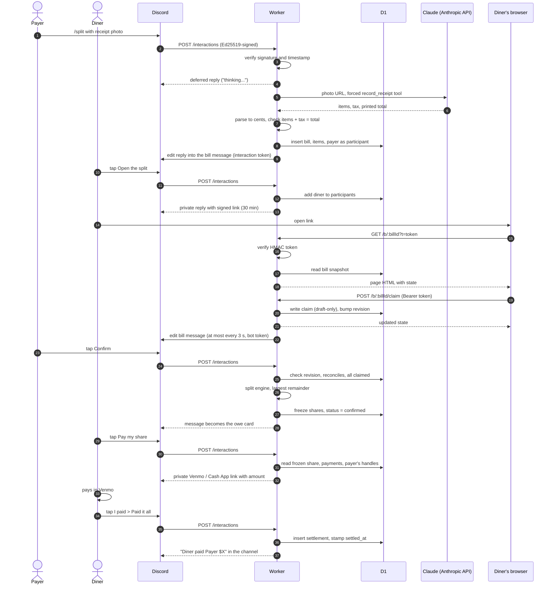

# Architecture

How AAzhi works, end to end. This follows one bill from the moment someone
photographs a receipt to the moment the last friend pays, and at each step
names the component involved, what it does, why it exists, and the file that
implements it. The split page is described by what it does rather than how it
looks, so this stays true through a redesign.

For why each technology was chosen over its alternatives, see
[stack.md](stack.md). For deploying a copy, see [setup.md](setup.md).

## The pieces, in one paragraph each

**Discord** is where the group already talks. AAzhi is a Discord *app*: an
account Discord lets a program act through, with its own slash commands and
buttons. People never talk to AAzhi's servers directly from Discord; they use a
command or tap a button, and Discord forwards that to AAzhi.

**The Cloudflare Worker** is all of AAzhi's server code. A Worker is a program
Cloudflare runs on demand, once per incoming HTTPS request, on its own
machines. There is no server sitting idle between requests and nothing to keep
alive. Entry point: [`src/index.ts`](../src/index.ts).

**D1** is the database. It is Cloudflare's hosted SQLite, attached to the
Worker as a *binding* (a handle Cloudflare passes into the Worker, here named
`DB`, so the code reaches the database without a connection string or
password). Schema: [`migrations/`](../migrations).

**Claude** (Anthropic's Haiku model, called over the Anthropic API) reads the
receipt photo and returns the line items as structured data. Code:
[`src/extract/`](../src/extract).

**The split page** is a web page the same Worker serves, where each person
claims what they ate. Code: [`src/web/`](../src/web).

**Venmo and Cash App** are never called by AAzhi. It only builds links that
open those apps with the amount filled in; the money moves between friends,
never through AAzhi.

## Component diagram



## Following one bill

### 0. Before any bill: the commands exist

Discord only shows a slash command if the app registered it. `npm run
register-commands` sends the list in
[`src/discord/commands.ts`](../src/discord/commands.ts) to Discord once:

- `/split` with up to three photo attachments (`receipt`, `page_2`, `page_3`).
- *Split this receipt*, a **message command**: an entry under *Apps* when you
  right-click or long-press a message, for when the photos are already posted.
- `/paywith method handle`, where the payer saves their Venmo, Cash App or
  Zelle handle once.
- `/ledger`, who still owes you, in this server or everywhere.

The registration script is [`scripts/register-commands.ts`](../scripts/register-commands.ts).
It authenticates with the bot token and replaces the whole command set.

Discord is also told one URL, the **interaction endpoint**: the Worker's
address plus `/interactions`. Whenever anyone uses a command or taps a button,
Discord sends an HTTPS POST describing it (an *interaction*) to that URL and
waits up to three seconds for the reply. That is the only way Discord reaches
AAzhi. There is no persistent connection (Discord calls that a *gateway*
connection), which is why there is no always-running server. [stack.md](stack.md)
explains that choice.

### 1. The payer runs `/split`

Gavin paid for dinner, so Gavin runs `/split` with the receipt photo attached.
Discord uploads the photo to its own file storage (its CDN) and POSTs the
interaction to `/interactions`.

**Signature verification** comes first
([`src/discord/verify.ts`](../src/discord/verify.ts)). The endpoint is a public
URL, so anyone could POST to it pretending to be Discord. Discord signs every
request with its private key using **Ed25519** (a public-key signature scheme:
only the private key can produce a signature, and anyone holding the public
key can check one). The Worker checks the signature against
`DISCORD_PUBLIC_KEY` over the raw request bytes, plus a timestamp that must be
within five minutes so a captured request cannot be replayed later. Anything
that fails gets a 401 and goes no further. Discord also refuses to save the
endpoint URL until the Worker answers its signed test ping correctly.

**The router** ([`src/discord/interactions.ts`](../src/discord/interactions.ts))
looks at the interaction type. Commands are dispatched by name. Button taps are
dispatched by the button's `custom_id` prefix: every button AAzhi draws carries
an id like `confirm:<bill id>:<revision>`, so the handler knows which bill and
which version of it the button was drawn from.

**The split handler** ([`src/discord/handlers/split.ts`](../src/discord/handlers/split.ts))
has a problem: reading a receipt takes several seconds and Discord's deadline
is three. So it replies immediately with a *deferred* response, which makes
Discord show the bot as "thinking...", and keeps working after the reply using
`ctx.waitUntil` (a Worker feature that lets work continue for up to 30 seconds
after the response is sent). The original interaction includes an
**interaction token**, a credential Discord issues per interaction that lets
the app edit its reply for 15 minutes without the bot token.

### 2. Claude reads the receipt

[`src/extract/claude.ts`](../src/extract/claude.ts) calls the Anthropic
Messages API with `ANTHROPIC_API_KEY`. It sends the photo's Discord URL rather
than the photo itself, so Anthropic fetches the image and the multi-megabyte
file never passes through the Worker. AAzhi never stores the photo.

The request forces **tool use**: Claude must answer by filling in a single
"function call" with a fixed JSON schema (`record_receipt` in
[`src/extract/schema.ts`](../src/extract/schema.ts)) instead of free text. The
schema asks for each line's label and price, the printed tax, the printed
total, a per-line confidence, and whether the image is a receipt at all.

Prices come back as decimal strings like `"19.50"`, and the parser turns them
into integer cents (`1950`) by reading digits, never by multiplying a
floating-point number. Every amount in AAzhi is integer cents.

Then the **reconciliation check** (`reconciles` in `claude.ts`): the line items
plus the tax must equal the total printed on the receipt, to the cent. This is
how the app knows whether the read can be trusted, without needing the model to
be perfect. A bill that does not reconcile can still be fixed on the page but
cannot be confirmed until it does.

A malformed answer is retried once. Reading gets 20 seconds in total, so a hung
call fails with a "try again" message instead of leaving "thinking..." forever.

### 3. The bill is saved and posted

The handler writes the draft to D1 ([`src/db/bills.ts`](../src/db/bills.ts)):

| Table | One row per | Holds |
| --- | --- | --- |
| `bills` | bill | channel, payer, place, date, tax, tip, printed total, status, revision |
| `bill_items` | line on the receipt | label, cents (negative for a discount), confidence |
| `participants` | person on the bill | Discord user id, display name, or a guest and who brought them |
| `item_claims` | person who claimed a line | links an item to a participant |
| `shares` | person, written at confirm | the frozen subtotal, tax, tip and total they owe |
| `settlements` | payment recorded | who paid, how much, when |
| `payment_handles` | person and pay app | a Venmo username, $Cashtag or Zelle email/phone |

A bill's **status** is `draft` while people are claiming, `confirmed` once the
amounts are locked, `superseded` when a newer `/split` in the same channel
replaced an unconfirmed draft, and `deleted`. (A `reading` status exists in the
schema, but the current code only writes the bill once reading has succeeded.)
Its **revision** is a counter bumped by every change, so a button drawn from an
older version can be recognised and refused.

[`src/discord/render.ts`](../src/discord/render.ts) turns the bill into a
Discord message (an *embed*, Discord's formatted card): the items, the totals,
whether it reconciles, and the lines Claude was least sure of. It edits the
"thinking..." reply into that message through the interaction token
([`src/discord/rest.ts`](../src/discord/rest.ts)), stores the message's id so it
can be edited later, and marks any older unconfirmed draft in the channel as
superseded.

The message has **Open the split**, **Confirm** (once the bill can be
confirmed), **Delete**, and a member picker the payer can use to add people who
were at dinner.

### 4. Everyone opens the split page

Mai taps **Open the split**. [`src/discord/handlers/roster.ts`](../src/discord/handlers/roster.ts)
adds Mai to the bill's participants (tapping is how you join a draft) and
replies with a message only Mai can see (an *ephemeral* reply), holding a link:

```
https://<worker>/b/<bill id>?t=<token>
```

The token is how the page knows who Mai is without a login. It is an
**HMAC-signed token** ([`src/web/token.ts`](../src/web/token.ts)): a short
piece of JSON (bill id, Mai's Discord user id, an expiry 30 minutes out) plus a
signature computed from that JSON and a secret only the Worker knows,
`TOKEN_SIGNING_KEY`. HMAC (hash-based message authentication code) means
anyone can read the JSON, but nobody without the secret can change it or make
a new one that verifies. Discord already proved who tapped the button, so the
signed link carries that proof onto the web.

### 5. The split page

`GET /b/<bill id>?t=<token>` ([`src/index.ts`](../src/index.ts)) checks the
token before even looking the bill up, so a visitor with a bad link cannot tell
whether a bill exists. It then renders the page's HTML
([`src/web/page.ts`](../src/web/page.ts)) with the bill's current state
embedded, plus a script ([`src/web/client.ts`](../src/web/client.ts)) that makes
it interactive. Responses forbid caching and referrer headers, because the
token is in the URL and must not leak onward.

On the page:

- **Anyone on the bill** taps their own name onto the lines they had. A shared
  dish is split between exactly the people who tapped it.
- **The payer** can additionally tap others onto lines, edit or add or delete
  lines, set the tax, the tip (in dollars or as a percentage) and the printed
  total, add **guests** (someone at the table without Discord, whose share is
  billed to the member who brought them), and hand the bill to a different
  payer before anyone has paid.
- **After confirm**, the payer can **forgive** someone's share. The payer
  absorbs it; nobody else's amount changes, and the bot announces it in the
  channel.

Each action is a small JSON request to the **page API**
([`src/web/api.ts`](../src/web/api.ts)) at `/b/<bill id>/claim`, `/item`,
`/guest`, `/pardon`, or `PATCH /b/<bill id>`, sending the same token as an
`Authorization: Bearer` header. The API decides permissions from the token:
only the payer may change anything but their own claims. Every response returns
the whole updated bill, and the script also re-fetches `/b/<bill id>/state`
every five seconds while the tab is visible, so everyone sees everyone else's
taps.

Two concurrency rules keep this safe with several people tapping at once:

- **Draft-only writes are enforced in the SQL itself.** Each write's `WHERE`
  clause requires the bill to still be a draft, so a Confirm landing a
  millisecond earlier cannot have its frozen numbers moved underneath it.
- **The Discord message is updated at most once per three seconds per bill.**
  Every tap would otherwise be a Discord edit, and Discord rate-limits those.
  The first write to need an edit takes a short **lease** recorded in the
  `bills` row (`edit_lease_until`), waits three seconds, then renders the latest
  state; writes during that window skip their own edit because the pending one
  will include them. The lease lives in D1 rather than memory because each
  request may run on a different Worker instance, and they share nothing else.
  Code: `editBillMessage` in [`src/discord/rest.ts`](../src/discord/rest.ts).

A link expires after 30 minutes; tapping **Open the split** again gives a fresh
one.

### 6. The payer confirms

Gavin taps **Confirm**. [`src/discord/handlers/lifecycle.ts`](../src/discord/handlers/lifecycle.ts)
calls `confirmBill` in [`src/db/bills.ts`](../src/db/bills.ts), which refuses
unless the tapper is the payer, the button's revision is still current, the
bill reconciles, and every line is claimed. If some lines are unclaimed, the
bot offers to split them evenly between everyone who claimed something, then
confirm.

**The split engine** ([`src/money/split.ts`](../src/money/split.ts)) computes
each person's share. It is pure arithmetic, with no database or network:

1. Each line's cents are divided between its claimants, with any leftover cent
   going to the first claimants by id.
2. Each person's tax and tip are proportional to their subtotal, so the $45
   steak carries more tax than the $12 soup.
3. Proportional shares rarely come out in whole cents. **Largest remainder
   rounding** gives everyone the rounded-down amount, then hands the missing
   cents one at a time to whoever was closest to the next cent. The shares
   then add up exactly to the bill total plus tip. All of it is integer (and
   BigInt) arithmetic.

The results are written to the `shares` table and the bill becomes
`confirmed`. From now on, the numbers people see are those frozen rows, not a
fresh calculation, so nobody is ever shown an amount different from the one
they were asked to pay. The message turns into the **owe card**: who owes the
payer what, with **Pay my share**, **I paid**, **Show my math**, **That's not
mine**, and the payer's **Undo a payment**, **Reopen** and **Delete**.

### 7. Paying

Every person who covers bills runs `/paywith` once
([`src/discord/handlers/owe.ts`](../src/discord/handlers/owe.ts)). The handle
is validated against each app's own rules and saved in `payment_handles`, keyed
on their Discord id, so it applies to every bill they pay for.

Mai taps **Pay my share**. The bot works out what Mai still owes (Mai's own share,
plus any guests Mai brought, minus anything forgiven or already paid) and
replies privately with a button per method the payer has set up
([`src/web/paylink.ts`](../src/web/paylink.ts)):

- **Venmo**: `https://venmo.com/<user>?txn=pay&amount=44.46&note=...`, which
  opens Venmo with the amount and a note filled in.
- **Cash App**: `https://cash.app/$<cashtag>/44.46`, which fills in the amount.
- **Zelle** has no public link format, so it gets written instructions instead.

**Show my math** explains the number: Mai's lines, Mai's slice of tax and tip, and
the fraction of the bill that produced them.

### 8. Recording the payment

After sending the money, Mai taps **I paid**
([`src/discord/handlers/settle.ts`](../src/discord/handlers/settle.ts)) and
picks **Paid it all** or **Paid part** (which opens a form for the amount).
`recordSettlement` in [`src/db/settlements.ts`](../src/db/settlements.ts) adds a
row to `settlements`. All the rules (bill still confirmed, amount not more than
what's left, the remaining amount unchanged since the button was drawn) are in
the insert's own `WHERE`, so a reopen or a second tap landing in between cannot
sneak a bad payment through. A partial payment uses the Discord interaction id
as the row id, so if Discord delivers the same submit twice it is recorded
once.

The bot says the payment out loud in the channel ("Mai paid Gavin $44.46 for
..."). When a person's payments reach what they owe, their share's
`settled_at` is stamped. The payer can **Undo a payment** recorded by mistake.

`/ledger` adds it all up for the payer: who still owes them, across every
confirmed bill, in this server or everywhere.

### 9. When something is wrong

- **That's not mine**: any diner can tap it. The bill goes back to `draft`,
  paying pauses, and the channel is told. Claims and payments are kept.
- **Reopen**: the payer does the same deliberately.
- **Re-confirm**: when a reopened bill is confirmed again, anyone who already
  paid and whose amount changed is told the new figure and the difference.
- **Delete**: asks once first; if payments exist, the question names them.

## The whole flow



## Deployment

Every push to `main` runs [`.github/workflows/deploy.yml`](../.github/workflows/deploy.yml)
on GitHub Actions: install, type-check, run the tests, apply any new database
migrations, then `wrangler deploy` to publish the new Worker. Migrations go
first, and each must leave the schema usable by the old code, since the old
Worker keeps serving until the new one lands. The workflow authenticates to
Cloudflare with `CLOUDFLARE_API_TOKEN` and `CLOUDFLARE_ACCOUNT_ID`. The five app
secrets are not involved: they were stored on the Worker once and survive
deploys.

Tests ([`test/`](../test), run by `npm test`) execute inside workerd, the same
runtime Cloudflare uses, against a real D1 database built from the migrations.
A second Node project covers the few checks workerd can't run, like compiling
the page script.

## Trust boundaries

Three places where AAzhi decides whether to believe a request:

| From | To | Proven by |
| --- | --- | --- |
| Discord | Worker, `/interactions` | Ed25519 signature checked with `DISCORD_PUBLIC_KEY` |
| A browser | Worker, `/b/...` | HMAC token signed with `TOKEN_SIGNING_KEY`, naming one person on one bill, 30-minute expiry |
| Worker | Discord, Anthropic | `DISCORD_BOT_TOKEN` or the interaction token; `ANTHROPIC_API_KEY` |

Inside Discord, identity comes from Discord: the interaction says who tapped,
and every payer-only button re-checks that the tapper is the payer, because a
message's buttons are visible to everyone in the channel.

## Credentials and what each one is for

Every secret and ID the setup asks for. None of their values belong in this
repository except the two marked as committed.

| Name | Issued by | What AAzhi uses it for | Where it is stored | Secret? |
| --- | --- | --- | --- | --- |
| `DISCORD_APPLICATION_ID` | Discord Developer Portal, General Information | Identifies the app in Discord API paths: editing interaction replies (`src/discord/rest.ts`) and registering commands (`scripts/register-commands.ts`) | Worker secret; `.dev.vars` | No |
| `DISCORD_PUBLIC_KEY` | Discord Developer Portal, General Information | Checking that each request to `/interactions` really came from Discord (`src/discord/verify.ts`) | Worker secret; `.dev.vars` | No |
| `DISCORD_BOT_TOKEN` | Discord Developer Portal, Bot page (shown once) | Acting as the bot: editing bill messages, posting channel messages (`src/discord/rest.ts`), registering commands | Worker secret; `.dev.vars` | **Yes** |
| `ANTHROPIC_API_KEY` | Anthropic Console (shown once) | Calling Claude to read receipts (`src/extract/claude.ts`) | Worker secret; `.dev.vars` | **Yes** |
| `TOKEN_SIGNING_KEY` | You (`openssl rand -base64 32`) | Signing and checking split-page links (`src/web/token.ts`) | Worker secret; `.dev.vars` | **Yes** |
| D1 `database_id` | Cloudflare, printed by `wrangler d1 create` | Telling Wrangler which database the `DB` binding means | Committed in `wrangler.jsonc` | No |
| `CLOUDFLARE_API_TOKEN` | Cloudflare dashboard, API Tokens | Letting GitHub Actions migrate D1 and deploy the Worker (`.github/workflows/deploy.yml`) | GitHub Actions repository secret | **Yes** |
| `CLOUDFLARE_ACCOUNT_ID` | Cloudflare dashboard | Telling Wrangler in CI which account to deploy to | GitHub Actions repository secret | No |
| Your Wrangler login | Cloudflare, via `wrangler login` | Running the manual setup and deploy commands from your machine | Wrangler's config in your home directory | **Yes** |

Two more credentials exist only at runtime and are never configured: the
**interaction token** Discord includes with each interaction (valid 15 minutes,
lets the Worker edit that one reply), and the **split-page tokens** the Worker
mints for each person.

What each would expose if leaked:

- **`DISCORD_APPLICATION_ID`**: nothing. It is public; it appears in the bot's
  invite link.
- **`DISCORD_PUBLIC_KEY`**: nothing. It is a public key. It can check
  Discord's signatures but cannot make them, so it cannot forge requests to the
  Worker.
- **`DISCORD_BOT_TOKEN`**: full control of the bot account. An attacker could
  post as the bot in every channel it can see, edit or delete the bot's
  messages (including bill cards), and replace its slash commands. Reset
  it on the Bot page, then store the new one with `wrangler secret put
  DISCORD_BOT_TOKEN` and update `.dev.vars`.
- **`ANTHROPIC_API_KEY`**: an attacker could run their own Claude requests
  billed to your Anthropic account until the credit runs out. Revoke it in the
  Anthropic Console and store a new one.
- **`TOKEN_SIGNING_KEY`**: an attacker could mint split-page links as anyone,
  for any bill whose id they know (bill ids are random UUIDs, but they appear in
  the button data of the bill message, so anyone in the channel can see them).
  As the payer, they could change a draft's lines, tax and tip, add guests, hand
  the bill to someone else, or forgive shares on a confirmed bill. They could
  not record or undo payments, which happen through Discord buttons and need
  Discord's own signature. Replace it with a new random value; the only side
  effect is that links already handed out stop working, and those expire within
  30 minutes anyway.
- **D1 `database_id`**: nothing on its own. Using it requires access to the
  Cloudflare account.
- **`CLOUDFLARE_API_TOKEN`**: the most dangerous one. With Workers and D1 edit
  rights, an attacker could deploy their own code as the Worker (which would
  then run with all five app secrets available to it) and read, change or drop
  every table in the database. Roll it in the Cloudflare dashboard, then update
  the GitHub secret.
- **`CLOUDFLARE_ACCOUNT_ID`**: nothing on its own. It is an identifier, not a
  password, and does not need to be kept secret.
- **Your Wrangler login**: everything your Cloudflare user can do, which
  includes everything the API token can. Run `npx wrangler logout` on a machine
  you no longer trust.

## File map

| Path | Role |
| --- | --- |
| `src/index.ts` | The Worker's routes: `/interactions`, `/b/:billId`, and the page API |
| `src/env.ts` | The bindings and secrets the Worker receives |
| `src/discord/verify.ts` | Ed25519 signature and timestamp check |
| `src/discord/interactions.ts` | Dispatches commands, buttons and forms to handlers |
| `src/discord/commands.ts` | The slash and message command definitions |
| `src/discord/handlers/split.ts` | `/split` and *Split this receipt*: read, save, post |
| `src/discord/handlers/roster.ts` | **Open the split** and the payer's member picker |
| `src/discord/handlers/lifecycle.ts` | Confirm, split unclaimed lines evenly, Reopen, Delete |
| `src/discord/handlers/owe.ts` | Pay my share, Show my math, That's not mine, `/paywith` |
| `src/discord/handlers/settle.ts` | I paid, Undo a payment, `/ledger` |
| `src/discord/render.ts` | Draws the draft message and the owe card |
| `src/discord/rest.ts` | Calls to Discord's API and the coalesced message edit |
| `src/extract/claude.ts`, `schema.ts` | The Claude call, the tool schema, cents parsing, reconciliation |
| `src/money/split.ts` | The split engine |
| `src/money/debtors.ts` | Who answers for which share (guests roll up to whoever brought them) |
| `src/web/token.ts` | Minting and checking signed page links |
| `src/web/page.ts`, `client.ts` | The split page's HTML and its browser script |
| `src/web/api.ts` | The page's JSON API and its permission rules |
| `src/web/state.ts` | The bill state the page renders from |
| `src/web/paylink.ts` | Handle validation and Venmo / Cash App / Zelle links |
| `src/db/bills.ts` | Bills, items, participants, claims, confirm and reopen |
| `src/db/settlements.ts` | Payments, undo, outstanding amounts, the ledger |
| `src/db/handles.ts` | Saved payment handles |
| `migrations/` | The D1 schema |
| `scripts/register-commands.ts` | Registers the commands with Discord |
| `.github/workflows/deploy.yml` | Test and deploy on push to `main` |
